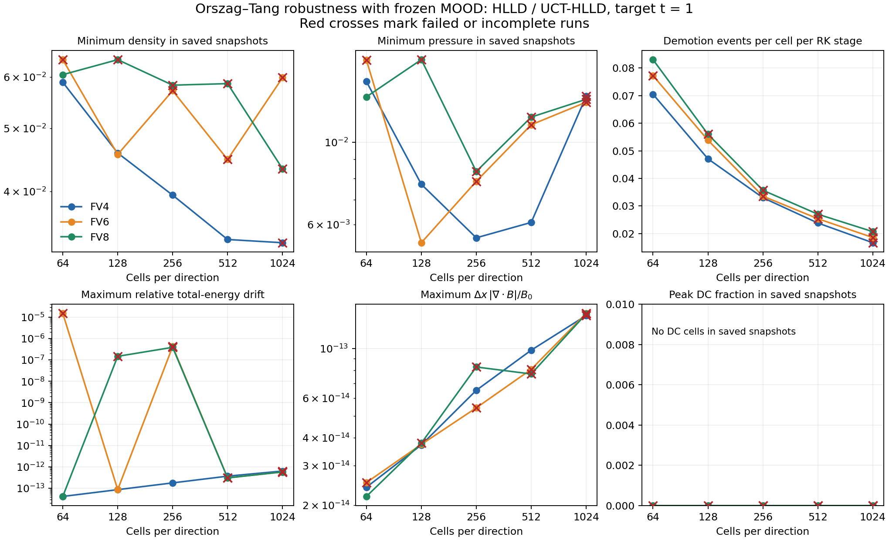
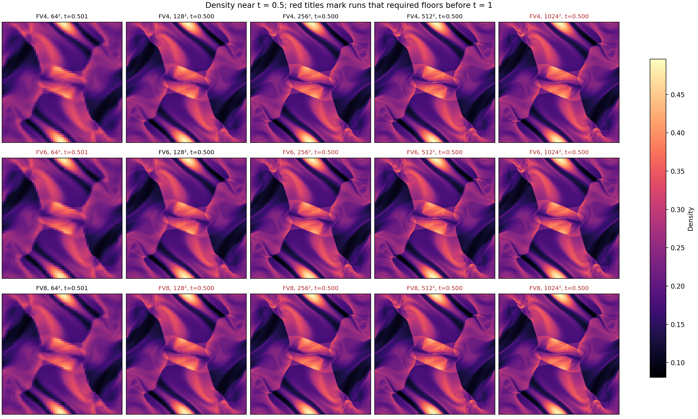
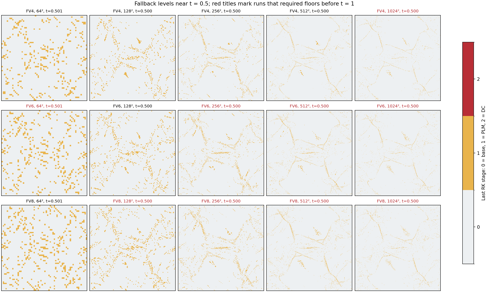
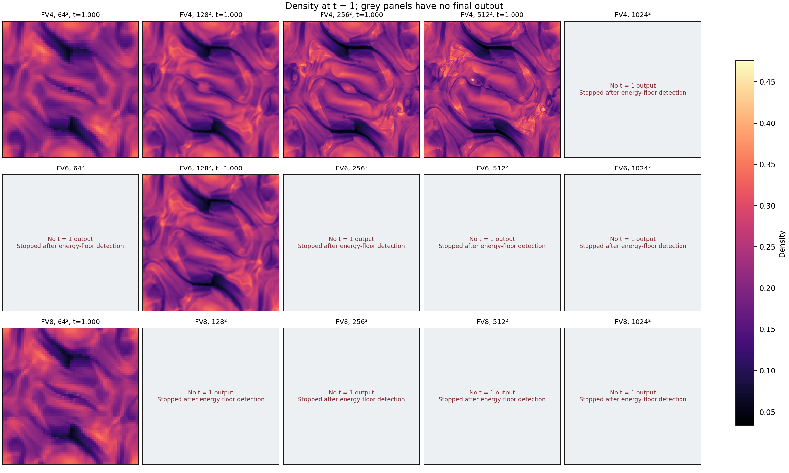
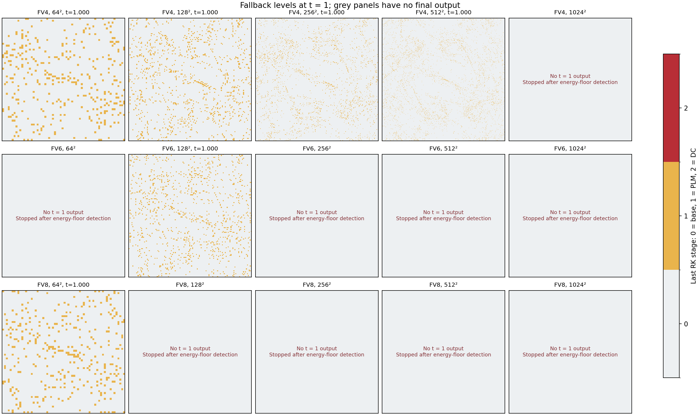

# Orszag–Tang resolution robustness study

The [new four-revision report](four_revision_rtol1e8/README.md) records the ongoing
`1e-8` sweep through 4096², including a detector consistency audit. Floor counters
in this historical study include ghost cells; their physical-cell classification
has not been established. The audit also identifies different magnetic-field
interpolants in PAD and production primitive conversion. Interpret the floor-based
outcomes below with these qualifications.

## Configuration

Apollo GPU 1, NVIDIA A100-PCIE-40GB; numerical implementation from
`903b6b9606a440ab2476aa49c17775e74e9ba7d9`. The small `ot_pgen.cpp` selector calls
the repository's stock `ProblemGenerator::OrszagTang`; the numerical method is
unchanged by this study.

- Newtonian ideal MHD, gamma = 5/3, periodic unit square [-0.5, 0.5]².
- FV4, FV6, FV8 at 64², 128², 256², 512², and 1024²; fixed 64² blocks.
- HLLD Riemann solver, UCT-HLLD EMFs, RK3, CFL = 0.25, target t = 1.
- `mood_frozen_emf=true`, two revisions, and 5/6/8 ghosts respectively.
- Cell-local `mood_nad_scale=rcfl`, `mood_rtol=1e-4`, `mood_atol=0`,
  `mood_eps0=1e-12`; SED enabled. NAD checks density, energy, velocity components,
  and magnetic components; its magnetic reference uses face averages.
- Edge flag demotion, `mood_touched_only=false`; density and pressure floors 1e-12.

The same settings are used at every resolution. Evolution and histories use double
precision; binary field output is single precision. History output is every 0.01,
and field snapshots are every 0.25 plus the initial and normal final outputs.
The output times can exceed their requested intervals by a timestep.

## Interpretation

**Clean** means reaching t = 1 with finite, positive saved states and zero actual
EOS floors or conversion failures. Ordinary PLM/DC demotions and rejected PAD
candidates are expected and are counted separately. The event log's `fofc` column
counts rejected candidate states in this MOOD configuration, rather than actual
EOS energy corrections.

The harness monitors actual floor/failure counters. If a run remains active when
one appears, the harness stops it and records the first affected cycle; return
code -15 in those cases is an intentional SIGTERM. A run can finish naturally
before the one-second monitor notices a rare floor. A floor result therefore does
not imply a solver crash, and these runs do not establish how the failing cases
would behave if continued with floors to t = 1.

Floor totals cover only the observed prefix and depend on the monitor's polling
interval. First-floor cycle/time is more useful for comparison. The recorded time
interval brackets that cycle between diagnostic outputs. Saved minima and
conservation histories in stopped cases can precede the first floor, so a positive
saved pressure or a small sampled energy drift does not erase a floor event.

Demotion rate is `events / (3 * N² * completed_steps)`. Both tier transitions count;
it is not the fraction of unique cells ever demoted. Snapshot PLM/DC fractions
refer to the last RK stage at that snapshot. Failed runs' cumulative rates cover
shorter physical intervals.

This is a robustness study at the specified parameters. It does not measure formal
FV convergence order, and it does not certify other solvers, tolerances, revision
counts, AMR, relativistic dynamics, or GPU MPI.

## Outcomes

**The current two-revision frozen path does not remain floor-free as resolution
increases.** Six of the fifteen primary cases meet the clean criterion.

| Resolution | FV4 | FV6 | FV8 |
|---|---|---|---|
| 64² | Clean | Energy floor (t ≈ 0.856) | Clean |
| 128² | Clean | Clean | Energy floor (t ≈ 0.942) |
| 256² | Clean | Energy floor (t ≈ 0.817) | Energy floor (t ≈ 0.816) |
| 512² | Clean | Energy floor (t ≈ 0.889) | Energy floor (t ≈ 0.871) |
| 1024² | Energy floor (t ≈ 0.891) | Energy floor (t ≈ 0.828) | Energy floor (t ≈ 0.849) |

Approximate floor times summarize the diagnostic bracket; exact brackets and
cycles are in `results.json`. All nine failing cases were intentionally stopped
after energy-floor detection. No density or temperature floors, velocity ceilings,
conversion failures, or nonfinite saved states were observed.

FV4 passes through 512² but requires energy floors at 1024². FV6 and FV8 have
additional failures at smaller grids, with non-monotonic coarse-grid outcomes.
The failing cases are not evidence of a solver crash; they show that fallback did
not prevent an actual EOS energy correction under this configuration.

The clean cases have maximum relative mass and total-energy drift of
3.66e-13 and 3.66e-13, respectively. Across all saved snapshots,
`dx * max(abs(div B)) / B0 <= 1.43e-13`, with `B0 = 1/sqrt(4*pi)`.
The magnetic divergence constraint remains small while energy positivity fails.
Momentum drift in the data is absolute because the initial net momenta vanish;
mass and energy drifts are relative to their nonzero initial totals.

## Focused controls

All controls use FV8 and the same HLLD/UCT-HLLD, CFL, detector, EOS and initial data.

| Path | Resolution | Revisions | Ghosts | Outcome |
|---|---:|---:|---:|---|
| Legacy | 128² | 2 | 15 | Clean |
| Frozen, wide halo | 128² | 2 | 20 | Energy floor (t ≈ 0.942) |
| Frozen | 128² | 3 | 8 | Clean |
| Frozen | 256² | 3 | 8 | Energy floor (t ≈ 0.818) |

The 8- and 20-ghost frozen 128² runs have the same first floor cycle, **1357**.
All sixteen saved files through t ≈ 0.75 match exactly, including conserved and
primitive fields, flags and div B. Increasing the halo does not remove this
failure. The legacy path reaches t = 1 without floors on the same 128² test.

A third revision removes the 128² failure but still encounters floors at 256².
These controls do not validate three revisions across the full resolution matrix.
They identify a positivity weakness that needs further work before claiming
robustness of the current frozen path at all these resolutions.

## Figures and data



Crosses mark cases that required floors and were stopped. Their minima, histories
and cumulative demotion rates cover their available prefixes. Sparse snapshots
contain no DC cells in this study; they do not resolve transient DC events between
outputs.





The maps use the scheduled t = 0.5 snapshot, before any observed floor event;
actual times appear in each panel. Red titles identify runs that later required
floors. These are common-time morphology and fallback comparisons, not final
states of the stopped runs.





Only six primary cases have t = 1 output: FV4 at 64²–512², FV6 at 128²,
and FV8 at 64². Grey panels mark the nine cases stopped after floor detection;
their earlier snapshots are not substituted for final states.

- `summary.csv`: compact metrics, including PLM/DC fractions near t = 0.5.
- `results.json`: complete histories, floor/demotion counts, time brackets,
  snapshot metrics, controls, halo comparison and executable hashes.
- `inputs/`: exact input decks for all primary runs and controls.
- `executable.sha256`, `environment.txt`, `configure.log`: build provenance.

Timing fields are informational: controls shared the GPU during part of the sweep,
and the 256² three-revision control was paused and resumed after the primary sweep.
They should not be used to compare performance.

## Reproduce

Use the recorded Apollo modules and an available GPU:

```sh
source /etc/profile.d/modules.sh
module load anaconda3/2024.06 nvhpc/24.5 cudatoolkit/12.4 openmpi/cuda-12.4/nvhpc-24.5/4.1.6
export CUDA_VISIBLE_DEVICES=1
cmake -S . -B build_ot -DCMAKE_BUILD_TYPE=Release -DAthena_ENABLE_MPI=OFF \
  -DKokkos_ENABLE_CUDA=ON -DKokkos_ENABLE_CUDA_LAMBDA=ON \
  -DKokkos_ARCH_AMPERE80=ON -DCMAKE_CXX_COMPILER="$PWD/kokkos/bin/nvcc_wrapper" \
  -DPROBLEM=../../validation/frozen_emf_halo/ot_resolution/ot_pgen
cmake --build build_ot -j8
python3 validation/frozen_emf_halo/ot_resolution/run_study.py --source . \
  --exe build_ot/src/athena --output ot_resolution_runs
python3 validation/frozen_emf_halo/ot_resolution/plot_study.py --source . \
  --runs ot_resolution_runs --output ot_resolution_figures
```

For controls, use a separate output directory and `--resolutions 128 --orders 8`,
adding `--legacy`, `--nghost 20`, or `--revisions 3` as appropriate. The extra
three-revision test uses `--resolutions 256 --orders 8 --revisions 3`.
The harness defaults to stopping active runs after actual floor/failure detection;
`--continue-after-floor` permits a separate continuation study. The per-case wall
timeout is 7200 seconds. `--resume` reuses completed result files.

Full raw binary outputs, logs, histories and the standalone `athena-ot` executable
remain on Apollo under
`/home/velasco/codex-validation/local-rcfl-gpu-20261014/ot-resolution`.
The earlier blast validation build and executable were restored after this study.

## Requested extension (in progress)

The next sweep uses four revisions and `mood_rtol = 1e-8`, with FV4/FV6/FV8
at 64², 128², 256², 512², 1024², 2048² and 4096². Other physical and detector
settings and the executable are unchanged. The required ghost counts are 7/7/8.
Runs remain sequential on Apollo GPU 1, with floor detection stopping each case.
The per-case timeout is increased to 172800 seconds for the larger grids.

```sh
python3 validation/frozen_emf_halo/ot_resolution/run_study.py --source . \
  --exe ot-resolution/athena-ot --output ot-resolution/four-revision-rtol1e-8 \
  --resolutions 64,128,256,512,1024,2048,4096 --orders 4,6,8 \
  --revisions 4 --rtol 1e-8 --timeout 172800 --resume
```

Raw outputs and incremental `results.json` are in
`/home/velasco/codex-validation/local-rcfl-gpu-20261014/ot-resolution/four-revision-rtol1e-8`.
The preliminary four-revision `1e-4` sweep was interrupted at the user's request;
its completed cases remain separately under `four-revision`. These extensions
are not included in the completed two-revision tables or figures above.
