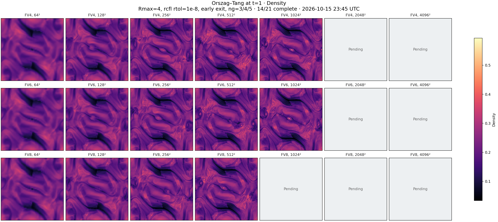
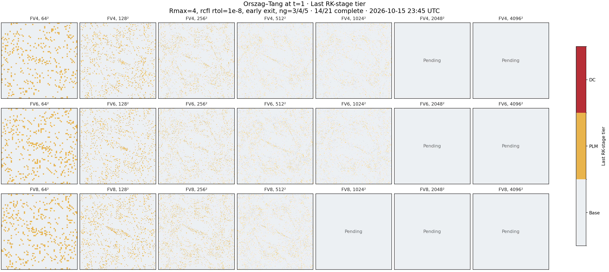
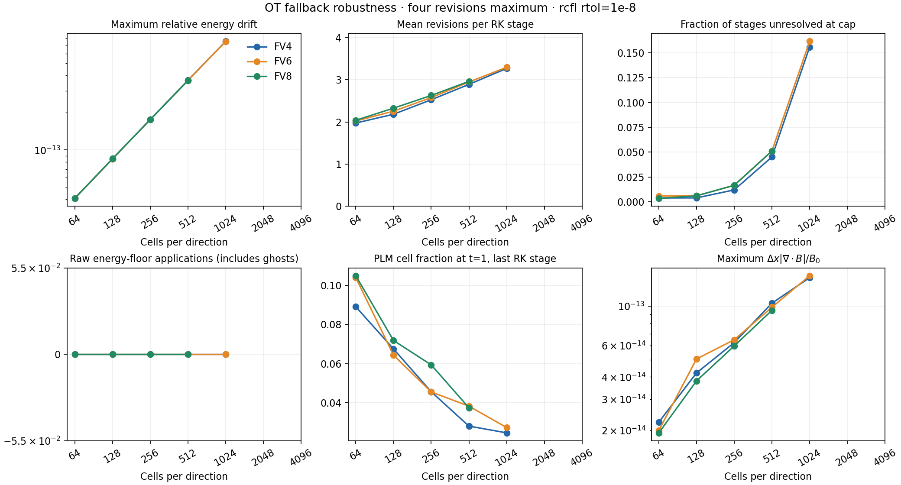

# OT fallback resolution study: early termination

Checkpoint: **2026-10-15 23:45 UTC**. **14/21** cases recorded; **14** reached t=1; **14** reached t=1 with finite, positive saved states and no EOS repairs or conversion failures.

Numerical source: `bdef110c34fecdefebcd0973945be92440a8dbc9` (early-exit implementation in `a22d8e7ed`). Apollo A100 GPUs 0 and 1, one independent case per GPU, one MPI rank per case. Shared numerical objects come from the fresh full production CUDA build; only the OT selector/dispatcher/config display are recompiled. Exact source/object/binary hashes and commands are in `build-provenance.json`.

FV4/FV6/FV8, 64–4096², 64² blocks, 3/4/5 ghosts; frozen high-order F/E, integer cascade exchange, magnetic volume-average detection; RK3, CFL=0.25, HLLD/UCT-HLLD, four revisions maximum, local rcfl NAD at rtol=1e-8, SED enabled. Density/internal energy/velocity components/magnetic components are detected. Floors are 1e-12. All inputs and raw logs are preserved.

Runs continue after EOS repairs to obtain t=1 maps. A red map title marks a completed case that did not meet the zero-repair criterion. Raw floor counters include ghost cells; they do not establish the number of repaired owned cells. A stage marked `revision_limit` still violates the detector at the cap; zero EOS repairs does not imply every NAD check converged. Fallback maps show only the last RK stage, not cumulative activity. Magnetic maps show the magnitude of magnetic cell averages derived from staggered faces. Snapshot fields are float32; evolution/history are double. Maps above 1024² are displayed by sampling every N/1024-th pixel; diagnostics use the full arrays. This is a robustness study, not a formal-order convergence measurement.

| N | FV4 | FV6 | FV8 |
|---|---|---|---|
| 64² | No EOS repairs; mean R=1.98; E floors=0 | No EOS repairs; mean R=2.02; E floors=0 | No EOS repairs; mean R=2.04; E floors=0 |
| 128² | No EOS repairs; mean R=2.18; E floors=0 | No EOS repairs; mean R=2.26; E floors=0 | No EOS repairs; mean R=2.33; E floors=0 |
| 256² | No EOS repairs; mean R=2.53; E floors=0 | No EOS repairs; mean R=2.58; E floors=0 | No EOS repairs; mean R=2.63; E floors=0 |
| 512² | No EOS repairs; mean R=2.89; E floors=0 | No EOS repairs; mean R=2.95; E floors=0 | No EOS repairs; mean R=2.96; E floors=0 |
| 1024² | No EOS repairs; mean R=3.27; E floors=0 | No EOS repairs; mean R=3.30; E floors=0 | Pending |
| 2048² | Pending | Pending | Pending |
| 4096² | Pending | Pending | Pending |

## Figures







[Pressure](pressure.png) · [Magnetic magnitude](magnetic.png) · [Metrics CSV](summary.csv) · [Full results](results.json)

## Reproduction and continuing batch

`run_study.py` in the parent directory supports a fresh OT executable built with
`PROBLEM=../../validation/frozen_emf_halo/ot_resolution/ot_pgen`. Use a Release
CUDA A100 build, double precision, MPI enabled, and bounds checking disabled.
For a sequential reproduction on one GPU:

```sh
CUDA_VISIBLE_DEVICES=0 OPENBLAS_NUM_THREADS=1 OMP_NUM_THREADS=1 python run_study.py \
  --source /path/to/source --exe /path/to/athena-ot --output /path/to/results \
  --orders 4,6,8 --resolutions 64,128,256,512,1024,2048,4096 --block 64 \
  --revisions 4 --rtol 1e-8 --mood-diagnostics --continue-after-floor \
  --tlim 1 --timeout 172800
```

The deployed two-GPU batch and export helpers are preserved in `helpers/`.
They expect the recorded Apollo directory layout. `build_ot.py` intentionally
requires the exact shared-core binary hash before relinking; a fresh full OT
CMake build can be used instead. The reference comparison covers all 75 saved
variable arrays per control: FV4/FV6/FV8 at 128² and FV4 at 512², all bitwise
identical to the earlier fixed-count implementation.

This committed checkpoint is immutable. The active batch on Apollo continues
through 4096². Its report and finite local collector update the workspace
`ot-fallback-resolution-study/` directory as cases complete; the collector exits
when all 21 cases are recorded. The committed checkpoint is not a completed
4096² study. Raw binary fields remain on Apollo; this portable report preserves
input decks, compressed raw logs, histories, figures, summaries, and provenance.
