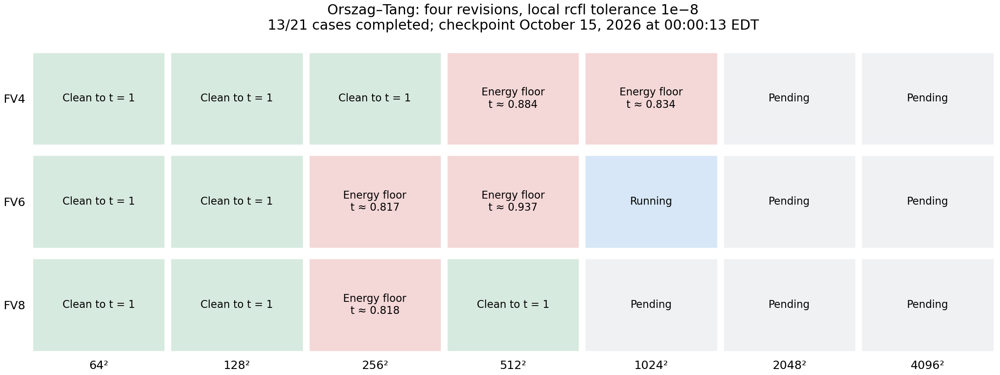
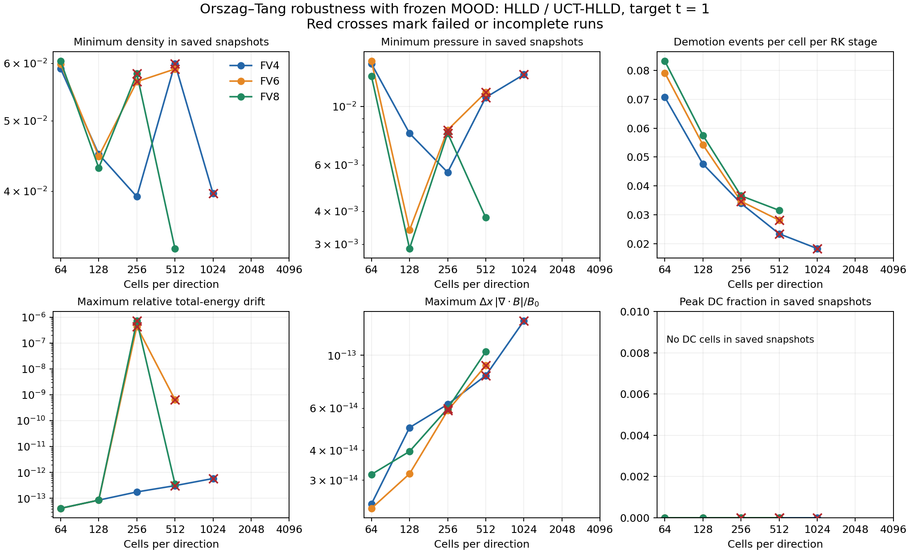
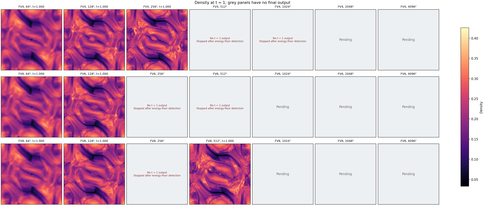
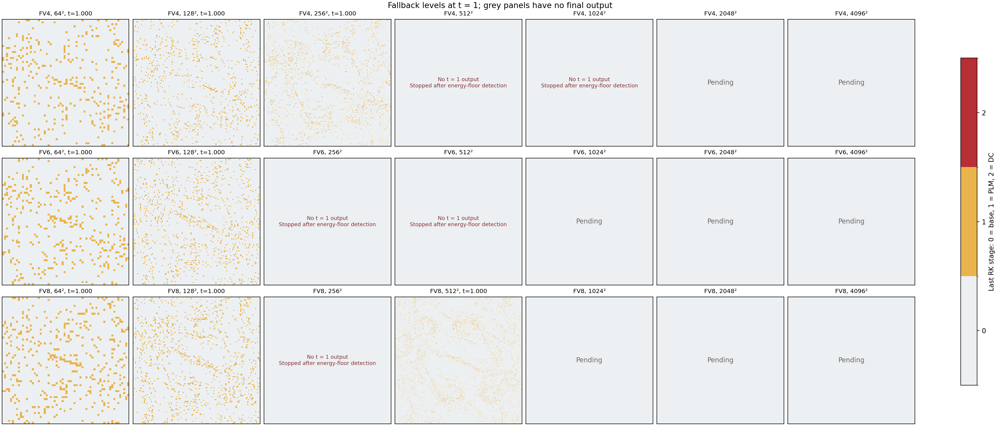

# Orszag Tang robustness with four revisions and tolerance 1e-8

Draft checkpoint: **October 15, 2026 at 00:00:13 EDT**. **13 of 21 cases completed:** 8 clean to t = 1,
5 with actual floor events, and 8 awaiting completed results.
The ongoing sweep covers FV4/FV6/FV8 through 4096². EOS counters include ghost
cells. A separate diagnostic reproduction confirms that the FV4 512² events
occur in physical cells and expose a PAD inconsistency.



## Configuration and scope

Newtonian ideal MHD, gamma = 5/3, stock Orszag–Tang initial data, periodic unit
square [-0.5, 0.5]². HLLD fluxes, UCT-HLLD EMFs, RK3 and CFL = 0.25.
The frozen path exchanges immutable high-order data before fallback revisions.
Four revisions use 7/7/8 ghost cells for FV4/FV6/FV8, with 64² meshblocks.
The local detector uses `mood_nad_scale=rcfl`, **`mood_rtol=1e-8`**,
`mood_atol=0`, `mood_eps0=1e-12` and SED enabled. NAD checks density, energy,
velocity components and magnetic components with a face-average magnetic reference.
`mood_edge=flag`, `mood_touched_only=false`; density and pressure floors are 1e-12.

Apollo GPU 1, NVIDIA A100-PCIE-40GB, single GPU without MPI. Numerical source base:
`903b6b9606a440ab2476aa49c17775e74e9ba7d9`. The executable is unchanged from the
earlier sweep; SHA256: `c5a9a53e2fcd24902ba341f6e932b2b281a5504c9cfcbeba2984a399ccf14ed8`.
Evolution and history use double precision; saved fields use single precision.
History cadence is 0.01; fields are saved every 0.25 and at normal completion.

## Results at this checkpoint

| Resolution | FV4 | FV6 | FV8 |
|---|---|---|---|
| 64² | Clean to t = 1 | Clean to t = 1 | Clean to t = 1 |
| 128² | Clean to t = 1 | Clean to t = 1 | Clean to t = 1 |
| 256² | Clean to t = 1 | Energy floor (0.8160055–0.8184400) | Energy floor (0.8171247–0.8197301) |
| 512² | Energy floor (0.8834502–0.8844739) | Energy floor (0.9360907–0.9373577) | Clean to t = 1 |
| 1024² | Energy floor (0.8339981–0.8345986) | Running | Pending |
| 2048² | Pending | Pending | Pending |
| 4096² | Pending | Pending | Pending |

Clean means reaching t = 1 with finite, positive saved states and zero actual EOS
floors or conversion failures. Energy-floor times above are diagnostic brackets
around the first affected cycle. Ordinary PLM/DC demotions and PAD rejections
are counted separately from actual floor corrections.

| Case | Steps | First floor cycle | Energy floors | Last diagnostic time | Last saved field time |
|---|---:|---:|---:|---:|---:|
| FV4 64² | 695 | — | 0 | 1.0000000 | 1.0000000 |
| FV6 64² | 695 | — | 0 | 1.0000000 | 1.0000000 |
| FV8 64² | 696 | — | 0 | 1.0000000 | 1.0000000 |
| FV4 128² | 1448 | — | 0 | 1.0000000 | 1.0000000 |
| FV6 128² | 1451 | — | 0 | 1.0000000 | 1.0000000 |
| FV8 128² | 1449 | — | 0 | 1.0000000 | 1.0000000 |
| FV4 256² | 2988 | — | 0 | 1.0000000 | 1.0000000 |
| FV6 256² | 2389 | 2317 | 108 | 0.8334597 | 0.7501607 |
| FV8 256² | 2352 | 2310 | 84 | 0.8272677 | 0.7500813 |
| FV4 512² | 5291 | 5263 | 35 | 0.8864998 | 0.7500514 |
| FV6 512² | 5739 | 5694 | 2 | 0.9412541 | 0.7500435 |
| FV8 512² | 6132 | — | 0 | 1.0000000 | 1.0000000 |
| FV4 1024² | 9950 | 9938 | 80 | 0.8351989 | 0.7500185 |

The harness stops an active case after detecting an actual floor or conversion
failure, polling every second. Return code -15 for these cases is an intentional
stop, not a solver crash. Floor totals depend on the delay before that stop;
first-floor cycle and time are better comparison measures. The last saved field
can precede the floor event, so positive snapshot minima do not establish positivity
through the stop time. Pending and running cases contribute no completed statistics.

## Comparison with the earlier sweep

| Case | Two revisions and 1e-4 | Four revisions and 1e-8 |
|---|---|---|
| FV4 64² | Clean to t = 1 | Clean to t = 1 |
| FV6 64² | Energy floor (0.8490844–0.8621443) | Clean to t = 1 |
| FV8 64² | Clean to t = 1 | Clean to t = 1 |
| FV4 128² | Clean to t = 1 | Clean to t = 1 |
| FV6 128² | Clean to t = 1 | Clean to t = 1 |
| FV8 128² | Energy floor (0.9393296–0.9454252) | Clean to t = 1 |
| FV4 256² | Clean to t = 1 | Clean to t = 1 |
| FV6 256² | Energy floor (0.8158190–0.8182446) | Energy floor (0.8160055–0.8184400) |
| FV8 256² | Energy floor (0.8147147–0.8173201) | Energy floor (0.8171247–0.8197301) |
| FV4 512² | Clean to t = 1 | Energy floor (0.8834502–0.8844739) |
| FV6 512² | Energy floor (≥ 0.8890625) | Energy floor (0.9360907–0.9373577) |
| FV8 512² | Energy floor (0.8704162–0.8715577) | Clean to t = 1 |
| FV4 1024² | Energy floor (0.8906487–0.8912070) | Energy floor (0.8339981–0.8345986) |

Completed cases that now reach t = 1 after earlier floor events: FV6 at 64², FV8 at 128², FV8 at 512².
Completed cases that now encounter floors after earlier clean results: FV4 at 512².
Both revision count and tolerance changed, and FV4/FV6 require larger halos.
These comparisons do not isolate the effect of tolerance or revision count.
The interrupted four-revision 1e-4 sweep is a separate partial dataset and is
excluded from this report. This study measures robustness, not formal accuracy order.

## Confirmed detector inconsistency

For this Newtonian configuration, NAD tests density, internal energy density,
all three velocity components and all three magnetic components. Bounds use the
stage-input 3 by 3 neighborhood, with local rcfl relaxation and smooth-extrema
exemptions. NAD applies only at the base tier and demotes to PLM; PAD and nonfinite
checks can demote PLM to donor cell.

The code currently forms candidate magnetic fields by averaging the CT-updated
faces for PAD, while production primitive conversion uses the unlimited FV
face-to-cell interpolant. PAD and production can therefore subtract different
magnetic energies from the same total energy. This inconsistency needs to be
resolved before treating the current PAD check as validation of the accepted
state. In an instrumented FV4 512² reproduction, all 35 observed energy-floor
events are in physical cells still at the base tier. At the first event, the
same conserved state gives internal energy `+3.2027924e-3` with the face average
and `-1.0961833e-5` with the production FV4 interpolant. The original first-floor
cycle, 5263, is reproduced with zero PAD rejections. This is a physical failure,
not a ghost-counter artifact. See the [audit and raw evidence](pad_audit/README.md).

Other cases still require physical-cell classification: their aggregate EOS
counters include ghosts. The main sweep retains its original executable, so
these results describe the implementation with this defect. No numerical fix
has been applied in this report.

The two-revision, 1e-4 FV4 512² control also passes with seven ghosts. All twenty
saved field datasets match the earlier five-ghost run bitwise. The halo increase
alone therefore does not explain the regression. The audit records remaining
parameter controls and a separate source-level relativistic velocity NAD issue.

## Conservation and fallback diagnostics

Across the 8 clean completed cases, maximum relative mass drift is
3.628e-13 and maximum relative total-energy drift is 3.632e-13.
For all completed saved snapshots, `dx * max(abs(div B)) / B0` is at most
1.393e-13, with `B0 = 1/sqrt(4*pi)`. The largest saved DC fraction is 0.000e+00;
sparse snapshots do not resolve transient DC use between outputs.
Failed cases' sampled histories can precede floor onset or include subsequent
floor corrections. Their drift is not a floor-free conservation measurement.



Demotion rates count events divided by `3 * N² * completed_steps`; both tier
transitions can count. These rates are not unique cell fractions, and failed
cases cover shorter intervals. Timing fields are not performance benchmarks:
the first case overlapped the end of the superseded sweep.

## Density and fallback at the final time





Only actual t = 1 states are shown. Grey panels distinguish absent final output
after a floor stop from cases without completed results. Earlier snapshots are
not substituted for final states. Fallback levels represent the last RK stage.

The [density](figures/density.png) and [fallback](figures/fallback.png) maps near
t = 0.5 provide an earlier common-time comparison; actual times are panel titles.

## Data and reproduction

- `results.json`: frozen checkpoint with histories, event counters and snapshot metrics.
- `checkpoint.json`: capture time, active cases and remote data location.
- `summary.csv`: metrics for completed cases only.
- `inputs/`: exact completed-case decks, logs, histories and result records.
- The [earlier report](../README.md) retains the two-revision study and controls.

From an Apollo environment with the modules in the earlier report:

```sh
python3 validation/frozen_emf_halo/ot_resolution/run_study.py --source . \
  --exe ot-resolution/athena-ot --output ot-resolution/four-revision-rtol1e-8 \
  --resolutions 64,128,256,512,1024,2048,4096 --orders 4,6,8 \
  --revisions 4 --rtol 1e-8 --timeout 172800 --resume
```

Raw binary fields and incremental live results remain on Apollo at
`/home/velasco/codex-validation/local-rcfl-gpu-20261014/ot-resolution/four-revision-rtol1e-8`.
This report freezes the checkpoint above; later completions require a refresh.
